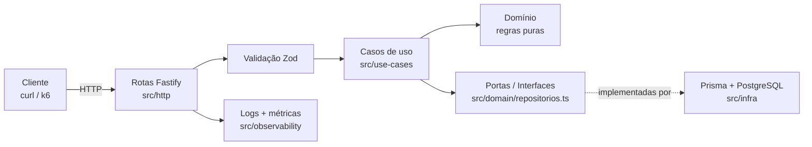

# API de Empréstimos de Biblioteca

**Nível: Projeto B** · Full Cycle — Módulo 4 · Encontro 24

[](https://github.com/JannioFSantos/cursoFullCycleEmprestimoLivros/actions/workflows/ci.yml)

> Uma API de domínio único, com **um fluxo principal funcionando de ponta a
> ponta** e todas as camadas do curso provadas: Docker Compose, SOLID,
> Repository, testes unitários e de integração, CI, logs estruturados, métrica,
> SLO, ADR, OpenAPI validado e teste de carga com p95 medido.

A regra que dá sentido ao projeto: **duas pessoas não podem levar o mesmo
último exemplar**, mesmo pedindo ao mesmo tempo. É essa corrida (e não o CRUD)
que justifica a arquitetura.

---

## Índice

- [Demonstração em 60 segundos](#demonstração-em-60-segundos)
- [O problema](#o-problema)
- [Stack](#stack)
- [Como rodar](#como-rodar)
- [Arquitetura](#arquitetura)
- [Decisões que você deve olhar](#decisões-que-você-deve-olhar)
- [Endpoints](#endpoints)
- [Testes e cobertura](#testes-e-cobertura)
- [Observabilidade e SLO](#observabilidade-e-slo)
- [Desempenho](#desempenho)
- [Deploy no Coolify](#deploy-no-coolify)
- [Estrutura do repositório](#estrutura-do-repositório)
- [Escopo (e não-escopo)](#escopo-e-não-escopo)
- [Checklist da rubrica](#checklist-da-rubrica)
- [Uso de IA](#uso-de-ia)
- [Apresentação](#apresentação)

---

## Demonstração em 60 segundos

Pré-requisitos: Docker e Docker Compose.

```bash
git clone https://github.com/JannioFSantos/cursoFullCycleEmprestimoLivros.git
cd cursoFullCycleEmprestimoLivros
cp .env.example .env

# sobe banco + API (a migration roda sozinha no start do container)
docker compose up -d --build

# opcional: dados de exemplo (roda da máquina, não do container)
npm install && npm run db:seed

curl http://localhost:3000/health
```

Resultado esperado:

```json
{ "status": "ok", "uptimeSegundos": 3 }
```

Fluxo completo:

```bash
# 1) cadastrar um livro com 1 exemplar
curl -s -X POST http://localhost:3000/livros \
  -H 'Content-Type: application/json' \
  -d '{"titulo":"Domain-Driven Design","autor":"Eric Evans","isbn":"9780321125217","exemplaresTotal":1}'

# 2) cadastrar dois usuários
curl -s -X POST http://localhost:3000/usuarios \
  -H 'Content-Type: application/json' \
  -d '{"nome":"Ana Souza","email":"ana@exemplo.com"}'

curl -s -X POST http://localhost:3000/usuarios \
  -H 'Content-Type: application/json' \
  -d '{"nome":"Bruno Lima","email":"bruno@exemplo.com"}'

# 3) Ana empresta (201)
curl -s -X POST http://localhost:3000/emprestimos \
  -H 'Content-Type: application/json' \
  -d '{"livroId":"<ID_DO_LIVRO>","usuarioId":"<ID_DA_ANA>"}'

# 4) Bruno tenta o mesmo exemplar (409 LIVRO_INDISPONIVEL)
curl -s -X POST http://localhost:3000/emprestimos \
  -H 'Content-Type: application/json' \
  -d '{"livroId":"<ID_DO_LIVRO>","usuarioId":"<ID_DO_BRUNO>"}'

# 5) Ana devolve, e agora Bruno consegue (201)
curl -s -X PATCH http://localhost:3000/emprestimos/<ID_DO_EMPRESTIMO>/devolucao
```

O passo 4 é o coração do projeto: **409 não é erro técnico, é a regra
funcionando**.

---

## O problema

Uma biblioteca empresta exemplares por 14 dias. As regras são poucas, mas
reais:

1. só empresta se houver **exemplar disponível**;
2. usuário com empréstimo **atrasado** não pega livro novo;
3. no máximo **3 empréstimos ativos** por usuário;
4. a devolução encerra o empréstimo e libera o exemplar.

O detalhe que torna o projeto interessante: a disponibilidade **não** é uma
coluna no banco. É sempre calculada como
`exemplares_total − empréstimos ativos`. E o empréstimo precisa ser atômico,
senão duas requisições simultâneas levam o mesmo último exemplar.

---

## Stack

| Camada | Escolha | Por que |
| --- | --- | --- |
| Runtime | Node.js 22 + TypeScript | tipagem ajuda a explicar o domínio |
| HTTP | Fastify 5 | validação e logs de qualidade, baixo overhead |
| Validação | Zod | erros 400 detalhados por campo |
| Banco | PostgreSQL 16 | transação e `SELECT ... FOR UPDATE` de verdade |
| Acesso a dados | Prisma 6 | migrations versionadas e queries tipadas |
| Logs | pino (embutido no Fastify) | JSON estruturado em produção |
| Métricas | prom-client | expõe `/metrics` no formato Prometheus |
| Testes | Vitest | rápido e com coverage nativo (v8) |
| CI | GitHub Actions | lint, testes, coverage, build e imagem |
| Carga | k6 | smoke test + cenários de leitura e escrita |

---

## Como rodar

### Opção A — tudo em Docker (recomendado)

```bash
cp .env.example .env
docker compose up -d --build
curl http://localhost:3000/health
```

O que acontece:

1. o Postgres sobe e fica `healthy`;
2. a API só inicia depois disso;
3. o entrypoint roda `prisma migrate deploy` (idempotente);
4. o Fastify escuta em `0.0.0.0:3000`.

Para ver os logs estruturados:

```bash
docker compose logs -f api
```

Para derrubar (mantendo os dados):

```bash
docker compose down
```

### Opção B — desenvolvimento local

```bash
cp .env.example .env
npm install

# só o banco
docker compose up -d db

# aplica as migrations e dados de exemplo
npm run db:deploy
npm run db:seed

# API com hot reload
npm run dev
```

### Comandos úteis

| Comando | O que faz |
| --- | --- |
| `npm run dev` | sobe a API com reload |
| `npm run build` | compila TypeScript para `dist/` |
| `npm start` | roda o build de produção |
| `npm run lint` | ESLint |
| `npm test` | todos os testes (precisa do banco) |
| `npm run test:unit` | só os testes de domínio e casos de uso |
| `npm run test:integration` | só o teste com banco real |
| `npm run test:coverage` | testes + cobertura |
| `npm run lint:openapi` | valida `docs/openapi.yaml` com Spectral |
| `npm run db:migrate` | cria migration nova em desenvolvimento |
| `npm run db:deploy` | aplica migrations pendentes (usado em produção) |
| `npm run db:seed` | popula 4 livros e 3 usuários |
| `npm run db:seed:volume` | gera volume para o teste de índice |
| `npm run db:studio` | abre o Prisma Studio |

---

## Arquitetura



A direção das setas é a regra de dependência: **o domínio não conhece Prisma,
Fastify nem HTTP**. A infraestrutura conhece o domínio; o domínio não conhece a
infraestrutura.

| Pasta | Responsabilidade | Não faz |
| --- | --- | --- |
| `src/domain` | entidades, regras, erros, interface dos repositórios | não importa Prisma nem Fastify |
| `src/use-cases` | orquestra um fluxo (emprestar, devolver) | não sabe status HTTP |
| `src/infra` | fala com o PostgreSQL via Prisma | não decide regra de negócio |
| `src/http` | valida entrada, chama caso de uso, monta resposta | não acessa banco direto |
| `src/observability` | métricas Prometheus | não conhece domínio |

---

## Decisões que você deve olhar

### 1. Padrão Repository (o pattern justificado)

`src/domain/repositorios.ts` define **interfaces**. Os casos de uso dependem
delas. `src/infra/repositories/*` implementa com Prisma.

Por que isso importa na prática: os 24 testes unitários rodam as mesmas regras
de produção **sem banco**, usando fakes em memória. Se o domínio dependesse
direto do Prisma, esses testes precisariam de container.

### 2. `SELECT ... FOR UPDATE` (ADR 0001)

O ponto crítico está em
`src/infra/repositories/prisma-emprestimo-repositorio.ts`. A transação:

1. trava a linha do livro (`FOR UPDATE`);
2. trava a linha do usuário (sempre nessa ordem, para evitar deadlock);
3. conta empréstimos ativos;
4. chama a função pura `validarEmprestimo` (a mesma dos testes);
5. insere o empréstimo.

Se a validação falhar, a transação é desfeita e a API responde 409.

Alternativas descartadas (coluna contador, Redis, constraint parcial) estão em
[`docs/adr/0001-disponibilidade.md`](docs/adr/0001-disponibilidade.md).

### 3. Relógio injetável

`src/domain/relogio.ts` define `Relogio`. Em produção, `relogioDoSistema`. Nos
testes, um relógio controlado. É assim que o teste de atraso "viaja 30 dias no
tempo" sem esperar 30 dias.

### 4. Erros de negócio com código estável

Todo erro segue o mesmo formato:

```json
{
  "erro": {
    "codigo": "LIVRO_INDISPONIVEL",
    "mensagem": "Não há exemplar disponível para este livro."
  }
}
```

Códigos: `LIVRO_NAO_ENCONTRADO`, `USUARIO_NAO_ENCONTRADO`,
`EMPRESTIMO_NAO_ENCONTRADO`, `LIVRO_INDISPONIVEL`, `USUARIO_COM_ATRASO`,
`LIMITE_ATINGIDO`, `EMPRESTIMO_JA_DEVOLVIDO`, `VALOR_JA_CADASTRADO`,
`DADOS_INVALIDOS`.

### 5. Disponibilidade calculada, nunca armazenada

`GET /livros` devolve `exemplaresDisponiveis` calculado no momento da consulta.
Não existe coluna contador para desviar da realidade.

---

## Endpoints

| Método | Rota | Sucesso | Erros esperados |
| --- | --- | --- | --- |
| GET | `/` | 200 | — |
| GET | `/health` | 200 | 503 se o banco cair |
| GET | `/metrics` | 200 | — |
| POST | `/livros` | 201 | 400, 409 (ISBN repetido) |
| GET | `/livros` | 200 | — |
| POST | `/usuarios` | 201 | 400, 409 (e-mail repetido) |
| GET | `/usuarios/:id` | 200 | 404 |
| POST | `/emprestimos` | 201 | 400, 404, 409 |
| PATCH | `/emprestimos/:id/devolucao` | 200 | 404, 409 |
| GET | `/emprestimos/atrasados` | 200 | — |

Contrato completo em [`docs/openapi.yaml`](docs/openapi.yaml) (OpenAPI 3.1,
validado pelo Spectral no CI).

Exemplo de resposta de empréstimo:

```json
{
  "id": "8c0f0d9e-6f8a-4c1d-9c1b-2f0b5c7a9d10",
  "livroId": "1a2b3c4d-...",
  "usuarioId": "5e6f7a8b-...",
  "status": "ATIVO",
  "dataEmprestimo": "2026-11-09T15:00:00.000Z",
  "dataPrevista": "2026-11-23T00:00:00.000Z",
  "dataDevolucao": null
}
```

---

## Testes e cobertura

```bash
npm run test:unit          # 24 testes, sem banco, ~1s
npm run test:integration   # 9 testes, API + PostgreSQL reais
npm run test:coverage      # tudo + cobertura
```

Política de cobertura declarada em `vitest.config.ts` e **respeitada no CI**:

| Métrica | Mínimo | Medido |
| --- | --- | --- |
| Statements | 90% | **98,27%** |
| Branches | 85% | **100%** |
| Functions | 90% | **95,23%** |
| Lines | 90% | **98,03%** |

A cobertura é medida **apenas em `src/domain` e `src/use-cases`**, onde ficam
as regras. Rotas e repositórios são exercitados pelo teste de integração, mas
não entram no número — é uma escolha explícita, não uma omissão.

O que os testes provam:

- cálculo de prazo e virada de mês;
- "vence hoje" não é atraso, "venceu ontem" é;
- as três regras de recusa (sem exemplar, atraso, limite);
- 404 de livro/usuário/empréstimo;
- devolução dupla retorna 409;
- fluxo HTTP completo com banco real, inclusive ISBN duplicado.

---

## Observabilidade e SLO

### Logs

Uma linha JSON por requisição (fora `/health` e `/metrics`):

```json
{
  "level": 30,
  "time": 1762700400000,
  "requisicaoId": "0d6e2a3f-...",
  "metodo": "POST",
  "rota": "/emprestimos",
  "status": 201,
  "duracaoMs": 12.4,
  "msg": "requisicao_concluida"
}
```

O `x-request-id` do cliente é respeitado; se não vier, geramos um UUID.
Cabeçalhos `authorization` e `cookie` são removidos por `redact`.

### Métricas

`GET /metrics` expõe:

| Métrica | Tipo | Uso |
| --- | --- | --- |
| `http_request_duration_seconds` | histograma | p95 por rota e status |
| `emprestimos_total{resultado}` | contador | criados x recusados |
| métricas padrão do processo | gauge/counter | CPU, memória, event loop |

### SLO

> **p95 de `POST /emprestimos` abaixo de 500 ms** e **p95 de `GET /livros`
> abaixo de 300 ms**, com menos de 1% de falha técnica nas leituras, medidos
> com 20 VUs de leitura e até 10 VUs de escrita por 1 minuto.

O número de escrita é maior de propósito: ele inclui a espera pelo
`FOR UPDATE`, que é o custo consciente da decisão de concorrência.

**Medido:** leitura p95 = 41,28 ms · escrita p95 = 264,48 ms · checks 100%.

---

## Desempenho

Metodologia, ambiente, números e análise do gargalo estão em
[`docs/desempenho.md`](docs/desempenho.md).

Resumo:

- smoke test: **5/5 checks**, p95 de **58,83 ms**;
- carga: **~687 req/s**, p95 de **41,28 ms** em leitura e **264,48 ms** em
  escrita (pior caso: todos disputando o mesmo livro);
- índice `(livro_id, status)`: **0,601 ms** vs **2,439 ms** sem índice em 20 mil
  empréstimos;
- o gargalo é o lock por livro, não a consulta — e isso é uma decisão
  consciente, documentada no ADR 0001.

---

## Deploy no Coolify

Guia passo a passo em
[`docs/deploy-coolify.md`](docs/deploy-coolify.md). Resumo:

1. crie um projeto no Coolify;
2. crie um recurso **PostgreSQL 16** e copie a URL interna;
3. crie a aplicação apontando para este repositório, build pack **Dockerfile**;
4. configure as variáveis (`DATABASE_URL`, `PORT=3000`, `HOST=0.0.0.0`);
5. exponha a porta `3000` e ative HTTPS;
6. deploy. As migrations rodam no entrypoint.

Nenhum segredo fica no repositório: apenas `.env.example`.

---

## Estrutura do repositório

```
.
├─ docker-compose.yml
├─ Dockerfile
├─ README.md
├─ CONTRIBUTORS.md
├─ prisma/
│  ├─ schema.prisma
│  ├─ migrations/
│  ├─ seed.ts
│  └─ seed-volume.ts
├─ scripts/
│  └─ entrypoint.sh          # migrate deploy + start
├─ docs/
│  ├─ adr/0001-disponibilidade.md
│  ├─ openapi.yaml
│  ├─ desempenho.md
│  ├─ deploy-coolify.md
│  ├─ apresentacao.md
│  └─ ia.md
├─ src/
│  ├─ config/env.ts
│  ├─ domain/                # regras puras
│  ├─ use-cases/             # orquestração
│  ├─ infra/                 # Prisma
│  ├─ http/                  # rotas, schemas, erros
│  ├─ observability/         # métricas
│  ├─ app.ts                 # composição
│  └─ server.ts              # listen + shutdown
├─ tests/
│  ├─ unit/
│  └─ integration/
├─ k6/
│  ├─ smoke.js
│  └─ load.js
└─ .github/workflows/ci.yml
```

---

## Escopo (e não-escopo)

**Entrou:**
- fluxo de empréstimo e devolução;
- regra de disponibilidade com concorrência;
- atraso, limite por usuário, validação e erros padronizados;
- 33 testes, CI completo, logs, métrica, SLO, ADR, OpenAPI, k6.

**Ficou de fora de propósito:**
- autenticação e autorização (não são o fluxo principal do B);
- frontend;
- filas, Redis, cache;
- paginação;
- multi-tenant.

Se o prazo apertasse, o corte seria o seed de volume e o segundo cenário do k6.
Nunca o fluxo principal.

---

## Checklist da rubrica

| Critério | Onde está a evidência |
| --- | --- |
| **M1 — Funciona, código e design (35)** | `docker compose up`; camadas em `src/`; `src/domain/repositorios.ts` (Repository); `prisma-emprestimo-repositorio.ts` (transação) |
| **M2 — Testes e CI (20)** | `tests/unit` (24), `tests/integration` (9), `vitest.config.mts` (thresholds), `.github/workflows/ci.yml` |
| **M3 — Ambientes e observabilidade (15)** | `.env.example`, `.dockerignore`, `src/config/env.ts`, `src/observability/metricas.ts`, logs no `src/app.ts`, SLO acima |
| **M4 — Arquitetura e desempenho (30)** | `docs/adr/0001-...`, `docs/openapi.yaml` + Spectral no CI, `k6/`, `docs/desempenho.md`, este README |

---

## Uso de IA

Declarado em [`docs/ia.md`](docs/ia.md): os prompts que mudaram o projeto, o
que foi aceito, o que foi recusado e o que foi verificado manualmente.

---

## Apresentação

Roteiro de 10 minutos, comandos para rodar ao vivo e perguntas prováveis em
[`docs/apresentacao.md`](docs/apresentacao.md).

---

## Autor

**Jannio Ferreira dos Santos**
Projeto individual — Full Cycle, Módulo 4, 2026.
