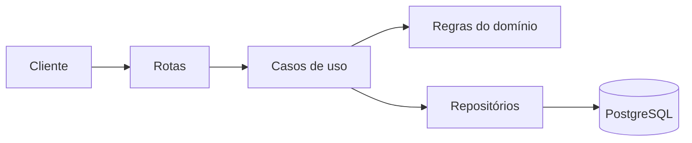

# Empréstimo de Livros — API

**Nível: Projeto B** (Full Cycle — Módulo 4)

[](https://github.com/JannioFSantos/cursoFullCycleEmprestimoLivros/actions/workflows/ci.yml)

Esse é o meu projeto final do curso. É uma API para controlar empréstimo e
devolução de livros de uma biblioteca.

Escolhi o **Projeto B** porque tinha 8 dias para entregar. Preferi fazer uma
coisa pequena funcionando de verdade do que um projeto grande pela metade.
Mesmo sendo simples, tentei usar o que aprendi no curso: Docker, separação de
camadas, testes, CI, logs, métricas e teste de carga.

## O que a API faz

- cadastra livro e usuário;
- empresta um livro por 14 dias;
- não deixa emprestar se não tem exemplar disponível;
- não deixa emprestar se o usuário está com livro atrasado;
- não deixa o usuário ter mais de 3 empréstimos ativos;
- registra a devolução;
- lista os empréstimos atrasados.

A parte mais importante é a regra do exemplar. Se duas pessoas tentarem pegar
o último exemplar ao mesmo tempo, uma recebe `201` e a outra recebe `409`. Para
isso usei uma transação no banco com `SELECT ... FOR UPDATE`.

## Tecnologias que usei

- **Node.js 22 + TypeScript** — linguagem do curso, com tipos;
- **Fastify** — servidor HTTP;
- **PostgreSQL 16** — banco de dados;
- **Prisma** — acesso ao banco e migrations;
- **Zod** — validação dos dados que chegam;
- **Vitest** — testes;
- **pino** — logs (já vem dentro do Fastify);
- **prom-client** — métricas para o Prometheus;
- **Swagger** — documentação interativa em `/docs`;
- **k6** — teste de carga;
- **Docker Compose** — subir tudo com um comando.

## Como rodar

### Com Docker (jeito mais fácil)

Precisa ter Docker e Docker Compose instalados.

```bash
git clone https://github.com/JannioFSantos/cursoFullCycleEmprestimoLivros.git
cd cursoFullCycleEmprestimoLivros
cp .env.example .env

docker compose up -d --build
```

Depois de uns segundos:

```bash
curl http://localhost:3000/health
```

Resposta esperada:

```json
{ "status": "ok", "uptimeSegundos": 5 }
```

Quando o container da API inicia, ele roda as migrations do banco sozinho
(`prisma migrate deploy`). Não precisa rodar nada à mão.

Para ver os logs:

```bash
docker compose logs -f api
```

Para parar:

```bash
docker compose down
```

### Sem Docker (para desenvolver)

```bash
cp .env.example .env
npm install

# sobe só o banco
docker compose up -d db

# cria as tabelas
npm run db:deploy

# dados de exemplo (opcional)
npm run db:seed

# API com reload automático
npm run dev
```

### Principais comandos

| Comando | O que faz |
| --- | --- |
| `npm run dev` | sobe a API em desenvolvimento |
| `npm run build` | compila para `dist/` |
| `npm start` | roda a versão compilada |
| `npm run lint` | roda o ESLint |
| `npm test` | roda todos os testes (precisa do banco) |
| `npm run test:unit` | só testes de regra, sem banco |
| `npm run test:integration` | só teste com banco |
| `npm run test:coverage` | testes + cobertura |
| `npm run db:deploy` | aplica as migrations |
| `npm run db:seed` | cadastra 4 livros e 3 usuários |
| `npm run db:studio` | abre o Prisma Studio |

## Como testar na mão

```bash
# 1. cadastrar um livro com 1 exemplar
curl -s -X POST http://localhost:3000/livros \
  -H 'Content-Type: application/json' \
  -d '{"titulo":"Domain-Driven Design","autor":"Eric Evans","isbn":"9780321125217","exemplaresTotal":1}'

# 2. cadastrar um usuário
curl -s -X POST http://localhost:3000/usuarios \
  -H 'Content-Type: application/json' \
  -d '{"nome":"Ana","email":"ana@exemplo.com"}'

# 3. emprestar (201)
curl -s -X POST http://localhost:3000/emprestimos \
  -H 'Content-Type: application/json' \
  -d '{"livroId":"<ID_DO_LIVRO>","usuarioId":"<ID_DO_USUARIO>"}'

# 4. devolver
curl -s -X PATCH http://localhost:3000/emprestimos/<ID_DO_EMPRESTIMO>/devolucao

# 5. ver os atrasados
curl -s http://localhost:3000/emprestimos/atrasados
```

Para testar a regra do último exemplar, cadastre um segundo usuário e tente
emprestar o mesmo livro. A resposta vai ser `409` com o código
`LIVRO_INDISPONIVEL`.

## Documentação da API (Swagger)

A própria API publica a documentação dela. Com a API rodando, abra no
navegador:

```
http://localhost:3000/docs
```

Nessa tela dá para ver todas as rotas, os dados que cada uma recebe, as
respostas e até testar direto pelo botão **Try it out**.

O contrato fica no arquivo `docs/openapi.yaml`. É o mesmo arquivo que o
Swagger mostra e que o CI valida com o Spectral. Se quiser o contrato em JSON,
basta acessar `/docs/json`.

Em produção fica no mesmo endereço da API:
`https://seu-dominio.com/docs`.

## Testes

```bash
npm run test:unit          # 24 testes, sem banco, roda em ~1s
npm run test:integration   # 10 testes, com banco real
npm run test:coverage      # tudo + cobertura
```

O que os testes cobrem:

- cálculo da data de devolução (inclusive virada de mês);
- livro que vence hoje não está atrasado, que venceu ontem está;
- as três regras de recusa: sem exemplar, atraso e limite de 3;
- livro, usuário ou empréstimo que não existe (404);
- devolver o mesmo empréstimo duas vezes (409);
- a documentação Swagger respondendo em `/docs`;
- o fluxo completo passando por HTTP e banco de verdade.

A cobertura é medida só em `src/domain` e `src/use-cases`, que é onde ficam as
regras de negócio. O mínimo está declarado no `vitest.config.mts` e o CI
quebra se cair abaixo.

| Métrica | Mínimo | Resultado |
| --- | --- | --- |
| Statements | 90% | 98,27% |
| Branches | 85% | 100% |
| Functions | 90% | 95,23% |
| Lines | 90% | 98,03% |

## Como o código está organizado



| Pasta | O que tem |
| --- | --- |
| `src/domain` | entidades, regras e erros. Não conhece banco nem HTTP |
| `src/use-cases` | o fluxo de emprestar e devolver |
| `src/infra` | implementação dos repositórios com Prisma |
| `src/http` | rotas, validação com Zod e tratamento de erro |
| `src/observability` | métricas do Prometheus |
| `tests/unit` | testes sem banco |
| `tests/integration` | testes com banco real |

## Decisões que tomei

### 1. Separei as regras do banco (padrão Repository)

As regras de negócio ficam em `src/domain`, e o acesso ao banco fica em
`src/infra`. No meio deles existe uma interface
(`src/domain/repositorios.ts`).

Fiz isso para conseguir testar as regras sem subir banco. Os 24 testes
unitários rodam em memória, com repositórios falsos.

### 2. Usei transação para o último exemplar

O problema: contar quantos empréstimos ativos o livro tem, ver se ainda sobra
exemplar e só depois inserir. Se duas requisições fizerem isso juntas, as duas
podem ver "tem 1 disponível" e as duas emprestarem.

A solução foi travar a linha do livro dentro de uma transação:

```sql
BEGIN;
SELECT id, exemplares_total FROM livros WHERE id = $1 FOR UPDATE;
-- conta os empréstimos ativos com a linha travada
INSERT INTO emprestimos (...) VALUES (...);
COMMIT;
```

Quem chega depois espera a primeira transação terminar. A explicação completa,
com as alternativas que descartei, está em
[`docs/adr/0001-disponibilidade.md`](docs/adr/0001-disponibilidade.md).

### 3. Criei um relógio que dá para trocar

Em vez de chamar `new Date()` em qualquer lugar, o código usa um objeto
`Relogio` (`src/domain/relogio.ts`). Em produção ele retorna a data de agora.
Nos testes, eu consigo "voltar no tempo" para simular um empréstimo atrasado
sem esperar 14 dias.

### 4. Padronizei os erros

Todos os erros têm o mesmo formato:

```json
{
  "erro": {
    "codigo": "LIVRO_INDISPONIVEL",
    "mensagem": "Não há exemplar disponível para este livro."
  }
}
```

Códigos usados: `LIVRO_NAO_ENCONTRADO`, `USUARIO_NAO_ENCONTRADO`,
`EMPRESTIMO_NAO_ENCONTRADO`, `LIVRO_INDISPONIVEL`, `USUARIO_COM_ATRASO`,
`LIMITE_ATINGIDO`, `EMPRESTIMO_JA_DEVOLVIDO`, `VALOR_JA_CADASTRADO` e
`DADOS_INVALIDOS`.

## Logs e métricas

Cada requisição gera uma linha de log em JSON, com id da requisição, rota,
status e tempo:

```json
{
  "requisicaoId": "0d6e2a3f-...",
  "metodo": "POST",
  "rota": "/emprestimos",
  "status": 201,
  "duracaoMs": 12.4,
  "msg": "requisicao_concluida"
}
```

Em `/metrics` ficam as métricas:

- `http_request_duration_seconds` — tempo de cada rota (para calcular p95);
- `emprestimos_total` — quantos empréstimos foram criados e quantos recusados;
- métricas padrão do Node (memória, CPU etc).

O SLO que defini foi: **p95 de `POST /emprestimos` abaixo de 500 ms** e
**p95 de `GET /livros` abaixo de 300 ms**, com menos de 1% de erro técnico nas
leituras.

Em um servidor de verdade, o `/metrics` deveria ficar fechado para fora e ser
lido só pelo Prometheus.

## Teste de carga

Resultado medido na minha máquina com Docker (os detalhes estão em
[`docs/desempenho.md`](docs/desempenho.md)):

| Teste | Resultado |
| --- | --- |
| Smoke (`k6/smoke.js`) | 5/5 checks, p95 de 58,83 ms |
| Carga (`k6/load.js`) | ~687 req/s |
| Leitura `GET /livros` | p95 de 41,28 ms |
| Escrita `POST /emprestimos` | p95 de 264,48 ms |

A escrita é mais lenta porque o teste força todo mundo a pedir o mesmo livro.
É o pior caso, e foi de propósito, para mostrar o custo do `FOR UPDATE`.

## Deploy no Coolify

O passo a passo completo está em
[`docs/deploy-coolify.md`](docs/deploy-coolify.md). Resumindo:

1. crie um PostgreSQL 16 no Coolify e copie a **URL interna**;
2. crie a aplicação apontando para este repositório;
3. escolha build pack **Dockerfile**;
4. configure as variáveis de ambiente;
5. exponha a porta `3000` e configure o domínio com HTTPS.

Variáveis necessárias:

| Variável | Valor |
| --- | --- |
| `NODE_ENV` | `production` |
| `PORT` | `3000` |
| `HOST` | `0.0.0.0` |
| `LOG_LEVEL` | `info` |
| `DATABASE_URL` | URL interna do PostgreSQL |
| `PRAZO_DIAS` | `14` |
| `LIMITE_EMPRESTIMOS` | `3` |

Nenhuma senha está no repositório. Só existe o `.env.example`, com valores de
exemplo.

## O que ficou de fora

Não fiz de propósito, para não perder o prazo:

- login e senha (autenticação);
- frontend;
- cache e fila;
- paginação;
- deploy com mais de uma instância.

Se eu tivesse mais tempo, começaria por cache no `GET /livros` e um teste de
carga com livros diferentes.

## Uso de IA

Está declarado em [`docs/ia.md`](docs/ia.md). Usei IA para tirar dúvidas,
revisar o ADR e gerar a primeira versão dos testes. As decisões e os números
são meus, e eu conferi tudo rodando.

## Apresentação

O roteiro de 10 minutos está em
[`docs/apresentacao.md`](docs/apresentacao.md).

## Autor

Jannio Ferreira dos Santos — projeto individual, 2026.
