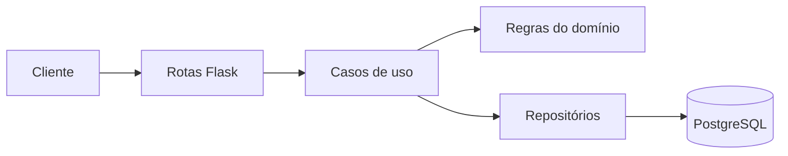

# Empréstimo de Livros — API (Projeto B)

**Nível: Projeto B** (Full Cycle — Módulo 4)

[](https://github.com/JannioFSantos/cursoFullCycleEmprestimoLivros/actions/workflows/ci.yml)

Esse é o meu projeto final do curso. É uma API para controlar empréstimo e
devolução de livros de uma biblioteca, escrita em **Python com Flask**.

Escolhi o **Projeto B** porque tinha pouco tempo para entregar. Preferi fazer
uma coisa pequena funcionando de verdade do que um projeto grande pela metade.
Mesmo sendo simples, tentei usar o que aprendi no curso: Docker, separação de
camadas, testes, CI, logs, métricas e teste de carga.

Esta é a versão Python do projeto, com o mesmo contrato de API da versão
anterior em TypeScript. Quem já usava os endpoints não precisa mudar nada.

## O que a API faz

- cadastra livro e usuário;
- edita e exclui livro e usuário (sem apagar histórico de empréstimos);
- lista livros, usuários e empréstimos (com o nome de quem pegou);
- empresta um livro por 14 dias;
- não deixa emprestar se não tem exemplar disponível;
- não deixa emprestar se o usuário está com livro atrasado;
- não deixa o usuário ter mais de 3 empréstimos ativos;
- registra a devolução;
- lista os empréstimos atrasados.

A parte mais importante é a regra do exemplar. Se duas pessoas tentarem pegar
o último exemplar ao mesmo tempo, uma recebe `201` e a outra recebe `409`. Para
isso uso uma transação no banco com `SELECT ... FOR UPDATE` (via SQLAlchemy).

Além da API, fiz uma tela simples de demonstração. Ela abre na raiz do site e é
renderizada no servidor com **Jinja**: não tem JavaScript nenhum no navegador.

## Tecnologias que usei

- **Python 3.12** — linguagem do projeto;
- **Flask 3.1** — servidor HTTP e templates Jinja;
- **PostgreSQL 16** — banco de dados;
- **SQLAlchemy 2.0** — acesso ao banco e transações;
- **psycopg 3** — driver do PostgreSQL;
- **Alembic** — migrations do banco;
- **Pydantic v2** — validação dos dados que chegam;
- **pytest** — testes unitários e de integração;
- **logging** da biblioteca padrão — logs em JSON;
- **prometheus_client** — métricas para o Prometheus;
- **flask-swagger-ui** — documentação interativa em `/API/docs`;
- **Locust** — teste de carga (substituiu o k6 da versão TypeScript);
- **Gunicorn** — servidor de produção dentro do container;
- **Docker Compose** — subir tudo com um comando.

## Como rodar

### Com Docker (jeito mais fácil)

Precisa ter Docker e Docker Compose instalados.

```bash
git clone https://github.com/JannioFSantos/cursoFullCycleEmprestimoLivros.git
cd cursoFullCycleEmprestimoLivros
cp .env.example .env

docker compose up -d --build
```

Depois de uns segundos:

```bash
curl http://localhost:3000/health
```

Resposta esperada:

```json
{ "status": "ok", "uptimeSegundos": 5 }
```

Agora abra `http://localhost:3000` no navegador. Essa é a tela de
demonstração. A API em si fica em `http://localhost:3000/API`.

Quando o container da API inicia, ele roda as migrations sozinho
(`alembic upgrade head`) e garante os dados de exemplo com um seed idempotente
(`python -m scripts.seed`). Não precisa rodar nada à mão. Se o banco já tiver
dados reais e você não quiser os exemplos, defina `SEED_ON_START=false`.

Para ver os logs:

```bash
docker compose logs -f api
```

Para parar:

```bash
docker compose down
```

### Sem Docker (para desenvolver)

Precisa de Python 3.12 e de um PostgreSQL. O jeito mais fácil de ter o banco é
subir só o serviço `db` do Compose.

```bash
cp .env.example .env

python -m venv .venv
source .venv/bin/activate        # Windows: .venv\Scripts\activate
pip install -r requirements-dev.txt

# sobe só o banco
docker compose up -d db

# cria as tabelas
alembic upgrade head

# dados de exemplo (opcional)
python -m scripts.seed

# API com reload automático
python -m app
```

### Principais comandos

| Comando | O que faz |
| --- | --- |
| `python -m app` | sobe a API em desenvolvimento, com reload |
| `gunicorn "app:create_app()"` | roda a versão de produção |
| `ruff check .` | roda o lint |
| `pytest` | roda todos os testes (precisa do banco) |
| `pytest tests/unit` | só testes de regra, sem banco |
| `pytest tests/integration` | só testes com banco |
| `pytest --cov --cov-report=term-missing` | testes + cobertura |
| `alembic upgrade head` | aplica as migrations |
| `python -m scripts.seed` | cadastra 10 livros e 5 usuários de teste |
| `python -m scripts.seed_volume` | gera 20 mil empréstimos para medir índice |
| `locust -f locust/smoke.py --headless -u 1 -r 1 -t 10s` | smoke test |
| `locust -f locust/load.py --headless -u 30 -r 5 -t 1m` | teste de carga |

## Como testar na mão

```bash
# 1. cadastrar um livro com 1 exemplar
curl -s -X POST http://localhost:3000/API/livros \
  -H 'Content-Type: application/json' \
  -d '{"titulo":"Domain-Driven Design","autor":"Eric Evans","isbn":"9780321125217","exemplaresTotal":1}'

# 2. cadastrar um usuário
curl -s -X POST http://localhost:3000/API/usuarios \
  -H 'Content-Type: application/json' \
  -d '{"nome":"Ana","email":"ana@exemplo.com"}'

# 3. emprestar (201)
curl -s -X POST http://localhost:3000/API/emprestimos \
  -H 'Content-Type: application/json' \
  -d '{"livroId":"<ID_DO_LIVRO>","usuarioId":"<ID_DO_USUARIO>"}'

# 4. devolver
curl -s -X PATCH http://localhost:3000/API/emprestimos/<ID_DO_EMPRESTIMO>/devolucao

# 5. ver os atrasados
curl -s http://localhost:3000/API/emprestimos/atrasados
```

Para testar a regra do último exemplar, cadastre um segundo usuário e tente
emprestar o mesmo livro. A resposta vai ser `409` com o código
`LIVRO_INDISPONIVEL`.

## Documentação da API (Swagger)

A própria API publica a documentação dela. Com a API rodando, abra no
navegador:

```
http://localhost:3000/API/docs
```

Nessa tela dá para ver todas as rotas, os dados que cada uma recebe, as
respostas e até testar direto pelo botão **Try it out**.

O contrato fica no arquivo `docs/openapi.yaml`. É o mesmo arquivo que o
Swagger mostra e que o CI valida com o `openapi-spec-validator`. Se quiser o
contrato em JSON, basta acessar `/API/docs/json`.

Em produção fica no mesmo endereço da API:
`https://agendadeconsultas.v6.rocks/API/docs`.

## Tela de demonstração

A tela fica em `https://agendadeconsultas.v6.rocks/` e é feita com Flask +
Jinja. Não tem framework de frontend, build de JavaScript nem chamadas `fetch`:
o HTML já chega pronto do servidor.

Ela tem as mesmas abas de antes, agora como páginas de verdade:

- **Visão geral** — números do dia e os últimos empréstimos;
- **Livros** — cadastro, catálogo com exemplares disponíveis e links de
  editar/excluir;
- **Usuários** — cadastro, lista de leitores e links de editar/excluir;
- **Empréstimos** — novo empréstimo, lista de quem pegou qual livro e botão
  de devolver;
- **Atrasados** — quem passou do prazo e quantos dias.

Os formulários usam `POST` e redirecionam de volta para a lista
(padrão POST/Redirect/Get), com mensagens de sucesso ou erro via `flash`.
Editar e excluir têm páginas próprias em vez de janelas de diálogo.

Tudo o que aparece na tela vem do mesmo banco que a API usa. Se você cadastrar
um livro ali, ele fica no banco de verdade e aparece em `GET /API/livros`.

## Testes

```bash
pytest tests/unit          # 39 testes, sem banco, roda em ~1s
pytest tests/integration   # 20 testes, com banco real
pytest --cov               # tudo + cobertura
```

O que os testes cobrem:

- cálculo da data de devolução (inclusive virada de mês);
- livro que vence hoje não está atrasado, que venceu ontem está;
- as três regras de recusa: sem exemplar, atraso e limite de 3;
- livro, usuário ou empréstimo que não existe (404);
- devolver o mesmo empréstimo duas vezes (409);
- editar livro e usuário, inclusive 404 para id inexistente;
- bloquear redução de exemplares abaixo dos empréstimos ativos;
- excluir livro/usuário com empréstimo preservando o histórico;
- deixar de listar (e de emprestar) o livro/usuário excluído;
- a tela de demonstração e a documentação Swagger respondendo;
- as listas que alimentam a tela (`GET /API/usuarios` e `GET /API/emprestimos`);
- o fluxo completo passando por HTTP e banco de verdade.

A cobertura é medida só em `app/domain` e `app/use_cases`, que é onde ficam as
regras de negócio. O mínimo está declarado no `pyproject.toml` e o CI quebra se
cair abaixo.

| Métrica | Mínimo | Resultado |
| --- | --- | --- |
| Cobertura total (linhas + branches) | 90% | 100% |

## Como o código está organizado



| Pasta | O que tem |
| --- | --- |
| `app/domain` | entidades, regras e erros. Não conhece banco nem HTTP |
| `app/use_cases` | emprestar, devolver, editar e excluir cadastros |
| `app/infra` | modelos SQLAlchemy e implementação dos repositórios |
| `app/http` | rotas, validação com Pydantic e tratamento de erro |
| `app/observabilidade` | logs em JSON e métricas do Prometheus |
| `app/web` + `app/templates` | tela de demonstração com Jinja, sem JavaScript |
| `app/static` | o único CSS da tela |
| `migrations` | migrations do Alembic |
| `tests/unit` | testes sem banco |
| `tests/integration` | testes com banco real |
| `locust` | smoke test e teste de carga |

## Decisões que tomei

### 1. Separei as regras do banco (padrão Repository)

As regras de negócio ficam em `app/domain`, e o acesso ao banco fica em
`app/infra`. No meio deles existe uma interface
(`app/domain/repositorios.py`), implementada com SQLAlchemy.

Fiz isso para conseguir testar as regras sem subir banco. Os 39 testes
unitários rodam em memória, com repositórios falsos (`tests/fakes.py`).

### 2. Usei transação para o último exemplar

O problema: contar quantos empréstimos ativos o livro tem, ver se ainda sobra
exemplar e só depois inserir. Se duas requisições fizerem isso juntas, as duas
podem ver "tem 1 disponível" e as duas emprestarem.

A solução foi travar a linha do livro dentro de uma transação:

```sql
BEGIN;
SELECT id, exemplares_total FROM livros WHERE id = $1 FOR UPDATE;
-- conta os empréstimos ativos com a linha travada
INSERT INTO emprestimos (...) VALUES (...);
COMMIT;
```

Quem chega depois espera a primeira transação terminar. A explicação completa,
com as alternativas que descartei, está em
[`docs/adr/0001-disponibilidade.md`](docs/adr/0001-disponibilidade.md).

### 3. Criei um relógio que dá para trocar

Em vez de chamar `datetime.now()` em qualquer lugar, o código usa um objeto
`Relogio` (`app/domain/relogio.py`). Em produção ele retorna a data de agora.
Nos testes, eu consigo "voltar no tempo" para simular um empréstimo atrasado
sem esperar 14 dias.

### 4. Padronizei os erros

Todos os erros têm o mesmo formato:

```json
{
  "erro": {
    "codigo": "LIVRO_INDISPONIVEL",
    "mensagem": "Não há exemplar disponível para este livro."
  }
}
```

Códigos usados: `LIVRO_NAO_ENCONTRADO`, `USUARIO_NAO_ENCONTRADO`,
`EMPRESTIMO_NAO_ENCONTRADO`, `LIVRO_INDISPONIVEL`, `USUARIO_COM_ATRASO`,
`LIMITE_ATINGIDO`, `EMPRESTIMO_JA_DEVOLVIDO`, `VALOR_JA_CADASTRADO`,
`EXEMPLARES_ABAIXO_DOS_EMPRESTIMOS` e `DADOS_INVALIDOS`.

### 5. Exclusão com histórico é lógica, não física

Se o livro ou o usuário nunca teve empréstimo, eu apago a linha do banco. Se
já teve, não apago nada: gravo a data em `excluido_em`. As listas filtram
`excluido_em IS NULL`, então o cadastro some da tela, mas a lista de
empréstimos continua mostrando o nome antigo com a etiqueta **excluído**.

Fiz assim porque apagar o livro apagaria também o registro de quem pegou. A
tela pergunta "deseja realmente excluir?" só quando existe histórico. A
explicação completa está em
[`docs/adr/0002-exclusao-logica.md`](docs/adr/0002-exclusao-logica.md).

## Logs e métricas

Cada requisição gera uma linha de log em JSON, com id da requisição, rota,
status e tempo:

```json
{
  "hora": "2026-11-11T12:00:00.000+00:00",
  "nivel": "info",
  "msg": "requisicao_concluida",
  "requisicaoId": "0d6e2a3f-...",
  "metodo": "POST",
  "rota": "/API/emprestimos",
  "status": 201,
  "duracaoMs": 12.4
}
```

Em `/metrics` ficam as métricas:

- `http_request_duration_seconds` — tempo de cada rota (para calcular p95);
- `emprestimos_total` — quantos empréstimos foram criados e quantos recusados;
- métricas padrão de processo (memória, CPU, threads, GC).

O SLO que defini foi: **p95 de `POST /emprestimos` abaixo de 500 ms** e
**p95 de `GET /livros` abaixo de 300 ms**, com menos de 1% de erro técnico nas
leituras.

Em um servidor de verdade, o `/metrics` deveria ficar fechado para fora e ser
lido só pelo Prometheus.

## Teste de carga

Resultado medido na minha máquina com Docker (os detalhes estão em
[`docs/desempenho.md`](docs/desempenho.md)):

| Teste | Resultado |
| --- | --- |
| Smoke (`locust/smoke.py`) | 5 requisições, 0 falhas, máximo de 48 ms |
| Carga (`locust/load.py`, 30 usuários por 60 s) | 4.539 requisições, 77,29 req/s |
| Leitura `GET /livros` | p95 de 85 ms |
| Escrita `POST /emprestimos` | p95 de 150 ms |

A escrita é mais lenta porque o teste força todo mundo a pedir o mesmo livro.
É o pior caso, e foi de propósito, para mostrar o custo do `FOR UPDATE`.

## Deploy no Coolify

O passo a passo completo está em
[`docs/deploy-coolify.md`](docs/deploy-coolify.md). Resumindo:

1. crie um PostgreSQL 16 no Coolify e copie a **URL interna**;
2. crie a aplicação apontando para este repositório;
3. escolha build pack **Dockerfile**;
4. configure as variáveis de ambiente;
5. exponha a porta `3000` e aponte o domínio
   `agendadeconsultas.v6.rocks` com HTTPS.

Em produção, a tela de demonstração fica em
`https://agendadeconsultas.v6.rocks`, a API em
`https://agendadeconsultas.v6.rocks/API` e o Swagger em
`https://agendadeconsultas.v6.rocks/API/docs`.

Variáveis necessárias:

| Variável | Valor |
| --- | --- |
| `APP_ENV` | `production` |
| `PORT` | `3000` |
| `HOST` | `0.0.0.0` |
| `LOG_LEVEL` | `info` |
| `DATABASE_URL` | URL interna do PostgreSQL |
| `SECRET_KEY` | valor aleatório, marcado como secret |
| `SEED_ON_START` | `true` (cria os dados de exemplo; use `false` com dados reais) |
| `PRAZO_DIAS` | `14` |
| `LIMITE_EMPRESTIMOS` | `3` |

Nenhuma senha está no repositório. Só existe o `.env.example`, com valores de
exemplo.

## O que ficou de fora

Não fiz de propósito, para não perder o prazo:

- login e senha (autenticação);
- cache e fila;
- paginação;
- deploy com mais de uma instância.

A tela de demonstração é só para mostrar a API funcionando. Ela não tem login,
não foi feita para celular com muito carinho e não substitui um frontend de
verdade.

Se eu tivesse mais tempo, começaria por cache no `GET /livros` e um teste de
carga com livros diferentes.

## Uso de IA

Está declarado em [`docs/ia.md`](docs/ia.md). Usei IA para tirar dúvidas,
revisar o ADR, gerar a primeira versão dos testes e ajudar na migração de
TypeScript para Python. As decisões e os números são meus, e eu conferi tudo
rodando.

## Apresentação

O roteiro de 10 minutos está em
[`docs/apresentacao.md`](docs/apresentacao.md).

## Autor

Jannio Ferreira dos Santos — projeto individual, 2026.
